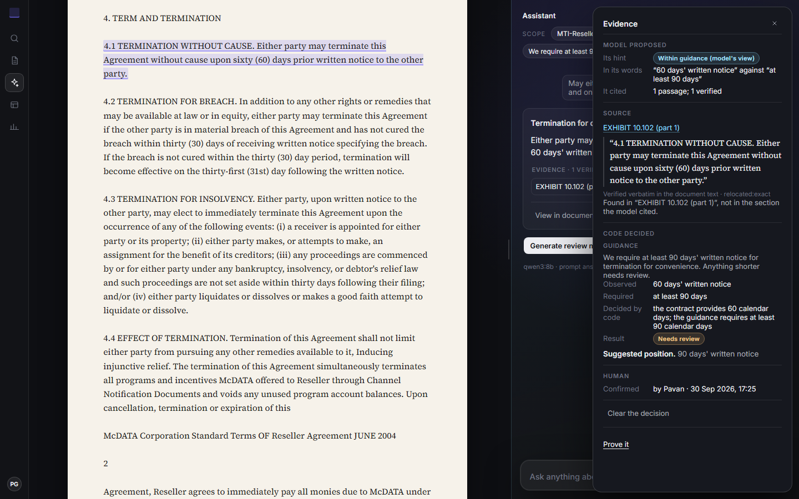

# Verity

Verity is an independent project by Pavankalyan Ghanta. It is not affiliated with or endorsed by Ivo.

**A contract AI can quote the right passage and still reach the wrong conclusion.** Verity shows where that happens. It
separates what code can check about an answer from what remains the model's reading, keeps the evidence for both, and
measures whether a fix holds on contracts it was not built on.



| Open | What it is |
|---|---|
| [ivo.pavankg.dev](https://ivo.pavankg.dev) | The workbench. Upload a contract (PDF, DOCX or TXT) or a sample, ask, open the cited passage, review. No sign-in: each browser gets a workspace of its own, deleted with everything in it 7 days after its first visit |
| [/break](https://ivo.pavankg.dev/break) | One recorded answer whose quote passed every check and still gave a right to the wrong party, the fix built to catch it, and why that fix was rejected |
| [/state](https://ivo.pavankg.dev/state) | A frozen research experiment on 5,414 SEC exhibits: when one contract arrives, which derived facts must be recomputed |

The application, the visitors' store and the model (Qwen3 8B through Ollama) run on one laptop behind a Cloudflare
Tunnel. Nothing a visitor adds is sent to a model host anywhere else, and the site answers only while that laptop is on.

## How an answer is made

1. **Read.** The contract is read into numbered sections and stored with its SHA-256. Whatever the reading left out,
   such as page footers, is named on screen and never cited.
2. **Retrieve and ask.** BM25 picks a handful of sections. The model answers in a fixed JSON schema, quoting the
   passages it relies on. Every answer is computed from its prompt's first token, so one input gives one answer
   ([casebook](docs/CASEBOOK.md), case 6).
3. **Check.** Code looks for every quote, word for word, in the document's own text, and withholds a finding whose quote
   it cannot find. Where guidance states a rule code can compare (a notice period against a minimum), code reports the
   shortfall itself. It lowers some passes whose quote leaves out an "unless", "except" or "subject to" from its own
   sentence, where the answer does not mention it, and it locates the contract's own amendment and precedence wording.
   Everything else stays the model's view, and the screen says which is which.
4. **Decide and keep.** A person confirms or dismisses each finding under a name. A finished run cannot be changed, and
   it can be rebuilt from its record to the same hash. Each run exports a memo and an evidence pack that checks itself
   with plain Python.

Code verifies that each quoted passage stands in the document's own text. It does not verify legal interpretation.

## Run it

```bash
# The API: Python 3.13, with Ollama serving qwen3:8b (ollama pull qwen3:8b)
cd backend
python -m venv .venv && source .venv/bin/activate      # Windows: .venv\Scripts\activate
pip install -r requirements.lock -r requirements-dev.txt
uvicorn app.main:app --port 8000

# The interface: Node 22, from the repository root in a second shell
npm ci
npm run dev -- -p 3900                                  # http://localhost:3900
```

Checks, with no model or GPU needed:

```bash
cd backend && pytest -q && ruff check . && mypy         # the backend: behaviour tests, properties, a fuzz of every route
npm test && npm run typecheck && npm run lint           # the interface
bash scripts/release-gate.sh <commit>                   # all of it on a fresh clone, plus the browser flows
```

What each check covers, and every number this README leaves out, is in [docs/STATUS.md](docs/STATUS.md).

## Reading it in ten minutes

| Read | To see |
|---|---|
| `backend/app/runs/service.py` | one run, stage by stage, and where each ending is decided |
| `backend/app/verify/spans.py` | how a quote is found in the document's own text, or not |
| `backend/app/runs/status.py` | the policy: when code, not the model, sets a status |
| `backend/app/providers/ollama.py` | the model call: never cut, computed from its first token |
| `backend/app/providers/admission.py`, `backend/app/application/quotas.py` | one model, one queue, bounded and counted |
| `backend/tests/test_read_cost.py`, `backend/tests/test_model_queue.py` | scaling invariants as tests: a read costs fixed queries, a full queue says so at once |
| `docs/CASEBOOK.md` | six failures traced to what the machine was doing: what located each, the mechanism, the fix and its test |
| `docs/TROUBLESHOOTING.md`, `backend/scripts/status.py` | how the live site is operated: one command, then a table of symptoms |
| `DECISIONS.md` | each decision as it was taken, with what was rejected |

## Layout

```
backend/app        the API: reading, retrieval, the run, the verifier, the policy, the model provider
backend/tests      behaviour tests, properties (Hypothesis), a fuzz of every route (Schemathesis), hostile files
backend/scripts    operator and research tools: status, goldens, data audit, evidence export
src/               the interface (Next.js): it renders what the API decided and decides nothing
e2e/               browser flows against the production build, with the model's answers replayed
deploy/            the laptop deployment (supervisor, tunnel) and a one-server cloud kit
docs/              casebook, failure envelope, troubleshooting, measurements; docs/archive holds dated notes
research/          experiments run against the product, kept as they were run
proof/             a static page of one recorded run
scripts/           the release gate
```

## How this was built

I built Verity as an independent engineering project, writing and editing substantial parts of the implementation
myself while working extensively with Claude Code and other AI coding agents. Claude Code generated much of the code,
tests, and documentation. I directed the engineering decisions, designed the experiments, challenged the results, and
decided what was worth keeping, changing, or rejecting.

One decision shaped the project. A proposed party-attribution check looked promising on the examples it was developed
against, but failed on unseen cases. Rather than ship a fix that didn't generalize, I rejected it and made the failure
part of the public investigation at [/break](https://ivo.pavankg.dev/break). AI agents also performed adversarial
reviews and helped adjudicate evaluation results. Those reviews were AI-assisted, not independent human validation.

The bundled sample (`public/samples/cloud-service-agreement.docx`) is Common Paper's Cloud Service Agreement, © Common
Paper, CC BY 4.0, unmodified.
